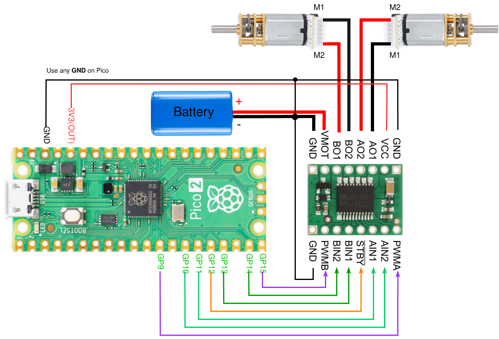
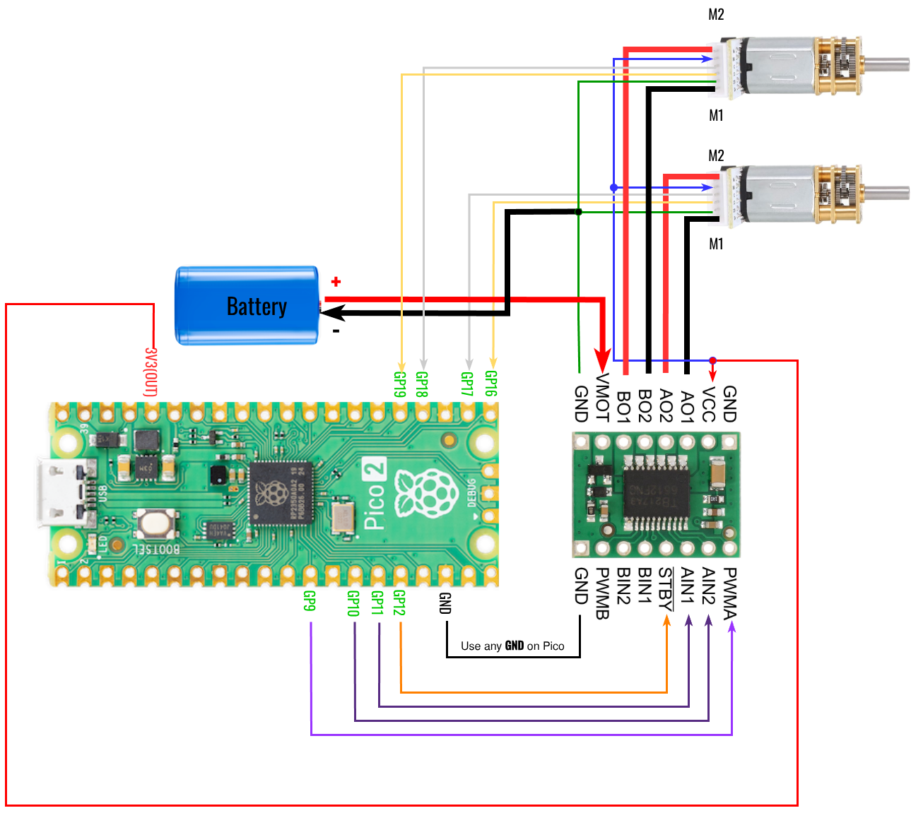

# Software Stack of Differential Drive Control

## Example Wiring Diagram
### 1. Motors Only


### 2. Motors + Encoders


## Installation

Upload [`diff_drive`](./diff_drive/) **directory** to the Pico board.
> [!NOTE]
> Contents:
> - [`motor.py`](./diff_drive/motor.py): spins a single motor.
> - [`encoder.py`](./diff_drive/encoder.py): counts encoder signal changes.
> - [`sentient_wheel.py`](./diff_drive/sentient_wheel.py): measures velocity of a wheel.
> - [`regulated_wheel.py`](./diff_drive/regulated_wheel.py): controls a wheel's velocity through PID control.
> - [`diff_drive_controller.py`](./diff_drive/diff_drive_controller.py): sets and monitors velocity of a differential drive mobile robot.

## Usage
Import the desired class to a **MicroPython** script to develop applications.

```Python
from diff_drive.diff_drive_controller import DiffDriveController

# SETUP
robot = DiffDriveController(
    left_wheel_configs={
        "motor_pin_ids": (9, 11, 10),
        "encoder_pin_ids": (16, 17),
    },
    right_wheel_configs={
        "motor_pin_ids": (15, 13, 14),
        "encoder_pin_ids": (18, 19),
    },
    enable_pin_id=12,
)
```

